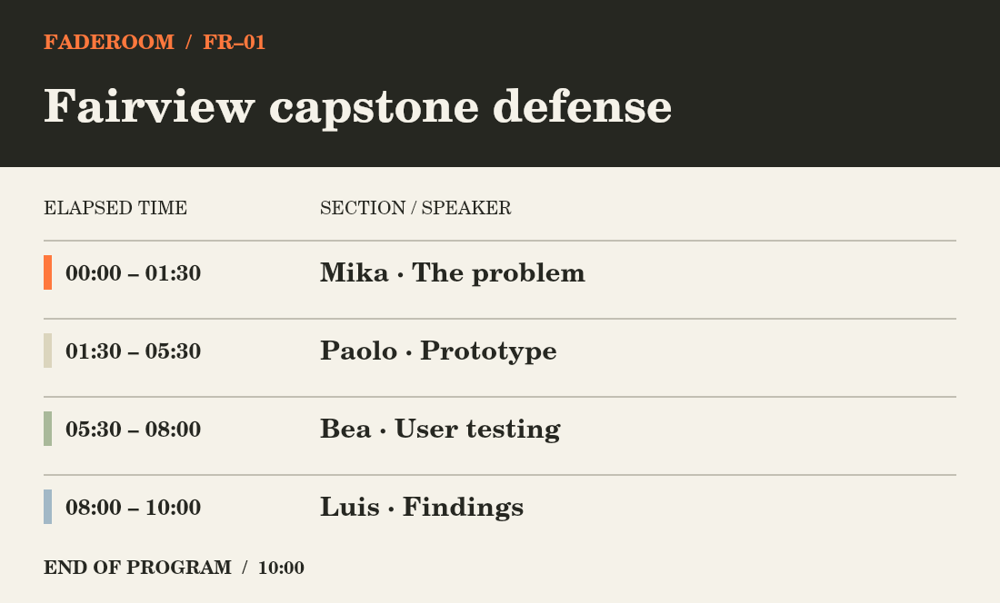

# Faderoom

A pocket-sized cue mixer for group presentations. Lock the live demo, slide time between speakers, and export a cue sheet with exact handoff times.

A Fairview BSIT group has rehearsed a ten-minute defense. The panel gives them eight. Paolo needs four full minutes to demonstrate the prototype. With his channel locked, the group can shorten the slot and see how much time Mika, Bea, and Luis each have left.

## Try the console

1. Open **index.html** and choose **Try an example**. The four channels initially share ten minutes.
2. Click **Lock** beside **Paolo · Prototype**. Press the slot **−** button eight times. The display now reads **08:00** and Paolo still has **04:00**.
3. Drag Mika’s fader right. The other unlocked sections give up time in 15-second steps. Watch Bea’s start time on the cue sheet.
4. Choose **Export PNG**. Send the image to the group chat. During rehearsal, start a stopwatch at zero and hand over when it reaches the next speaker’s start time.

Use **Tab** to focus a fader, then the **left/right arrow keys** to move it by one step. A fader needs another unlocked section to exchange time with. The slot controls can still resize a single unlocked channel.

## Make your own program

Choose **Edit program**, enter a title, and name two to six sections in speaking order. Each duration uses minutes and seconds, such as **02:15**. Their sum sets the initial slot, up to one hour. **Apply mix** commits the edit and resets locks. **Cancel** discards the edit.

The browser saves the applied program, fader positions, and locks after each change. Reopen the same address in the same browser to recover the mix. If storage is unavailable, the console shows **Session only** and export remains available. Unsaved changes in the program editor are temporary. A local file and a deployed site have separate storage.

## Open in VS Code

1. Extract the ZIP. In VS Code choose **File → Open Folder** and select the **Faderoom** folder that contains **index.html**.
2. In the Explorer pane, right-click **index.html** and choose **Reveal in File Explorer** on Windows or **Reveal in Finder** on macOS.
3. Double-click **index.html** in that folder to open the app in your browser. Edit in VS Code, save, and refresh the browser.

All scripts, styles, graphics, and fonts are local files or system resources. The application requires no package install, web server, account, or network connection.

## Publish with GitHub Pages

1. Create a public GitHub repository named **faderoom**.
2. Upload the **contents** of the extracted project folder to the repository root. The root should show **index.html**, **style.css**, **dial.svg**, **README.md**, and the **js**, **docs**, and **tests** directories. Commit to **main**.
3. Under **Settings → Pages → Build and deployment**, select **Deploy from a branch**. Choose **main**, select **/ (root)**, and save.
4. Once the Pages deployment finishes, open **Visit site** in Pages settings. Add that URL to the repository’s **About → Website** field so visitors can open the demo.

[GitHub’s publishing-source instructions](https://docs.github.com/en/pages/getting-started-with-github-pages/configuring-a-publishing-source-for-your-github-pages-site)

## Explain the code in a defense

| File | What to show |
| --- | --- |
| index.html | The physical console, native dialogs, and cue sheet. Deferred scripts load in dependency order, including when opened from disk. |
| style.css and dial.svg | Slotted screws, fader caps, ruler marks, responsive rows, and the three-fader logo. |
| js/mixer.js | Pure functions for time arithmetic, validation, and reallocation. A section stores a name, an integer count of 15-second ticks, and a lock flag. |
| js/app.js | Maps touch, pointer, keyboard, and form events to the model. Recalculates elapsed cues and saves the accepted state. |
| js/card.js | Draws a full-resolution cue sheet on Canvas from the same section data, then downloads it as a PNG. |
| tests/mixer.test.cjs | Optional model checks. From the VS Code terminal, run `node tests/mixer.test.cjs` if Node.js is installed. |

**Why the last handoff always fits.** An eight-minute slot contains 32 ticks. Lock a four-minute demo and exactly 16 ticks remain. Moving a fader sets one section’s allocation. The mixer gives each remaining unlocked section one tick, divides the rest in proportion to their previous spare time, then awards leftover ticks in descending order of fractional remainder. Ties go to the earlier section. Every tick ends up in one section. A running sum turns these durations into start and end times.

**Why dragging feels stable.** Each pointer drag begins with a snapshot of the mix. Each new position recalculates from that snapshot so repeated rounding during the same gesture cannot accumulate.

## Portfolio copy

**Repository description**

A tactile presentation-time mixer built with vanilla JavaScript. Lock sections, rebalance speaking time, and export a PNG cue sheet for your group.

**30-second walkthrough**

“Our panel just cut our ten-minute defense to eight. Paolo needs four minutes to show the prototype, so I lock his channel and shorten the slot. Now I can give Mika fifteen more seconds to explain the problem. Watch the handoffs change while the total stays at eight minutes. I export one cue card to the group chat. Everyone can see exactly when to take over.”

## Test report

See [TESTING.md](TESTING.md) for the executed checks and remaining browser checks.
